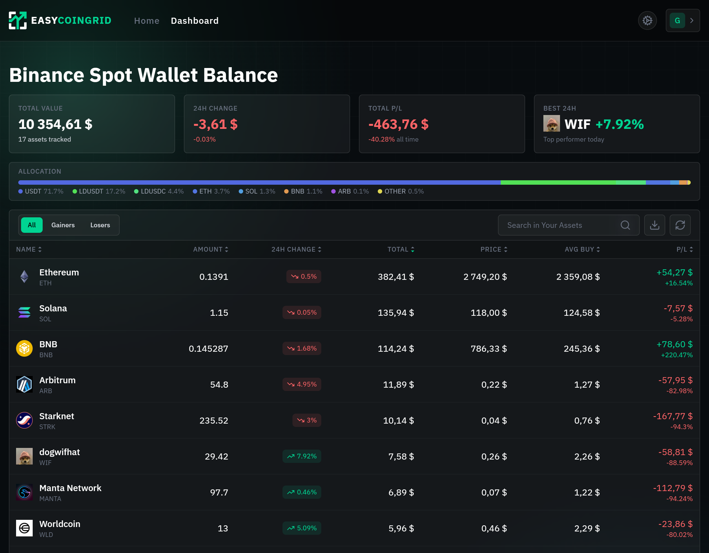

# EasyCoinGrid

EasyCoinGrid is a React application for viewing a Binance Spot portfolio. It displays asset balances, market prices, 24-hour changes, estimated average buy prices, and portfolio P/L. Users can connect Binance credentials, manage account settings, and choose a display currency.

## Demo

[Live Demo](https://easycoingrid.vercel.app)

## Screenshots



## Features

- Email registration, login, logout, session restoration, and password recovery/reset.
- Account settings for email and password updates.
- Binance connection and disconnection.
- Portfolio balances, asset prices, 24-hour changes, estimated average buy prices, and P/L calculations.
- Portfolio summary and allocation breakdown.
- Asset search, performance filters, sortable columns, and CSV export.
- Currency selection and exchange-rate conversion.
- Avatar upload and display.
- A public privacy policy describing account, exchange, and portfolio data handling.
- Loading, empty, Binance-not-connected, and error states.
- Optional mock portfolio data for development.

## Tech Stack

- React 19, TypeScript, Vite 8, Tailwind CSS 4
- React Router
- Supabase Auth, PostgreSQL, Storage, and Edge Functions
- Binance Spot API
- Vitest, React Testing Library, and Playwright
- GitHub Actions

## Architecture

The client is organized by feature. React pages and components use feature-level hooks and API modules; portfolio calculations are kept in utility functions. Supabase Edge Functions handle server-side Binance operations.

```text
src/
├── app/                 # App shell and shared header
├── features/
│   ├── auth/            # Authentication API, hook, forms, and pages
│   ├── portfolio/       # Portfolio API, hook, UI, mock data, calculations
│   └── settings/        # Account and Binance settings
├── pages/               # Home and dashboard pages
├── services/            # Avatar service
├── shared/              # Shared components, Supabase client, utilities
└── test/                # Vitest setup

supabase/
├── functions/           # Supabase Edge Functions
├── migrations/          # PostgreSQL and Storage migrations
└── config.toml

tests/e2e/               # Playwright end-to-end tests
.github/workflows/       # GitHub Actions workflows
```

## Authentication & Security

Supabase Auth is used for email-based registration and login. The client restores the current session with `getSession()` and subscribes to auth state changes. The application includes logout and password recovery/reset flows.

The `exchange_connections` table stores Binance credentials in encrypted form. The `connect-binance` Edge Function encrypts the API key and secret with AES-GCM using the server-side `BINANCE_ENCRYPTION_KEY`. Binance requests are signed server-side with HMAC-SHA256. The encryption key must remain server-side and must not be exposed through client-side `VITE_` variables.

Row Level Security is enabled on `exchange_connections`. Its policies restrict authenticated users' select, insert, update, and delete operations to rows whose `user_id` matches `auth.uid()`. Edge Functions also authenticate the caller and scope connection lookups to that user's ID.

Users can directly create, update, or delete only their own `MANUAL` spot rotations. `AUTO_API` rotations are recalculated from Binance trades inside the authenticated `get-binance-spot-trades` Edge Function and written through a database function executable only by `service_role`; the client cannot submit imported rotation rows directly.

The avatar Storage bucket is configured as **public**. Storage policies restrict authenticated upload, update, and listing operations by user folder, but public buckets allow file retrieval by URL without those access policies. Do not treat avatar URLs as private.

## Binance Integration

Supabase Edge Functions connect to Binance and retrieve Spot account balances. The portfolio flow fetches balances, then requests prices, 24-hour changes, average buy prices, and coin metadata. Portfolio calculations convert values to the selected currency and derive totals and P/L. Current USDT/USD and USDC/USD rates are calculated using Kraken bid-ask midpoints. Current Binance prices quoted in USDT are converted to USD using the USDT/USD rate. Average buy prices, historical portfolio snapshots, and imported rotation P/L still assume 1 USDT = 1 USD; they are estimates and are not recalculated with historical exchange rates.

The Binance account request uses `/api/v3/account`; the portfolio flow does not perform trading operations. Use Binance credentials with only the permissions needed for account-data access.

Portfolio data refreshes on a five-minute interval. Coin metadata failures are logged and do not prevent portfolio loading; price and average-buy requests are handled per asset, so an individual failure does not reject the entire portfolio load.

## Testing

Run unit and component tests:

```bash
npm run test:run
```

Vitest runs tests under `src/**/*.test.{ts,tsx}` in `jsdom`. The current suite covers portfolio calculations and `PortfolioTable` interactions using React Testing Library.

Run Playwright end-to-end tests:

```bash
npm run test:e2e
```

The E2E suite covers authentication and dashboard behavior, including asset search, filtering, sorting, and currency selection. It requires a configured Supabase project and test-account credentials. The dashboard tests expect the mock portfolio assets.

## CI

GitHub Actions runs lint, the production build, and unit/component tests on pushes and pull requests targeting `main` or `master`. Playwright end-to-end tests run when the Supabase project and test-account configuration is available.

To enable Playwright end-to-end tests in GitHub Actions, configure:

- `E2E_EMAIL` and `E2E_PASSWORD` secrets for an existing, confirmed Supabase test account.
- `VITE_SUPABASE_ANON_KEY` secret and `VITE_SUPABASE_URL` variable for the Supabase project.

The Playwright web server enables the mock portfolio, so dashboard tests use deterministic portfolio data instead of Binance. Authentication still uses the configured Supabase project. Public privacy policy coverage is also included in the E2E suite.

When those E2E settings are unavailable (for example, on fork pull requests), the workflow still runs lint, build, and unit/component tests and clearly reports that E2E was skipped.

## Getting Started

Requirements: Node.js and npm. A Supabase project is required to use authentication and backend functions.

1. Install dependencies:

   ```bash
   npm ci
   ```

2. Copy the example environment file:

   ```bash
   cp .env.example .env.local
   ```

   On Windows PowerShell:

   ```powershell
   Copy-Item .env.example .env.local
   ```

3. For local development, set `VITE_SUPABASE_URL` and `VITE_SUPABASE_ANON_KEY` in `.env.local`. These are required for Supabase authentication and backend requests.

   To load the bundled mock portfolio without connecting Binance, optionally set:

   ```dotenv
   VITE_USE_MOCK_PORTFOLIO=true
   ```

   Mock portfolio mode is available only in Vite development mode. It does not replace the Supabase configuration required for authentication.

4. Start the development server:

   ```bash
   npm run dev
   ```

5. Open the local URL printed by Vite.

E2E credentials are only needed to run Playwright tests. `BINANCE_ENCRYPTION_KEY` is only required for the Binance integration and must be configured as a Supabase Edge Function secret; it is not a client-side environment variable.

## Environment Variables

| Variable                  | Used by                  | Description                                                |
| ------------------------- | ------------------------ | ---------------------------------------------------------- |
| `VITE_SUPABASE_URL`       | Client and Playwright CI | Supabase project URL                                       |
| `VITE_SUPABASE_ANON_KEY`  | Client and Playwright CI | Supabase anon/publishable key                              |
| `VITE_USE_MOCK_PORTFOLIO` | Client, development only | Set to `true` to use the bundled mock portfolio            |
| `E2E_EMAIL`               | Playwright               | Email for the E2E test account                             |
| `E2E_PASSWORD`            | Playwright               | Password for the E2E test account                          |
| `BINANCE_ENCRYPTION_KEY`  | Supabase Edge Functions  | Key used to encrypt and decrypt stored Binance credentials |

The application only enables mock portfolio data when running in Vite development mode and `VITE_USE_MOCK_PORTFOLIO` is exactly `true`. E2E credentials should be kept out of source control. Keep `BINANCE_ENCRYPTION_KEY` server-side; do not expose it through a client-side `VITE_` variable.

## Project Structure

```text
.
├── .github/workflows/playwright.yml
├── src/
├── supabase/
├── tests/e2e/
├── .env.example
├── package.json
├── playwright.config.ts
├── vite.config.ts
└── vitest.config.ts
```

## Future Improvements

- Consider using an isolated Supabase test project for E2E runs.
- Expand automated coverage for settings and Supabase Edge Functions.
